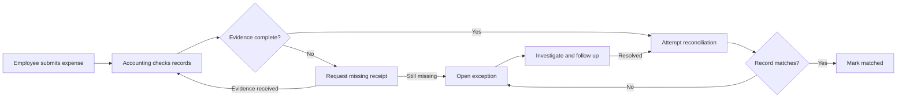
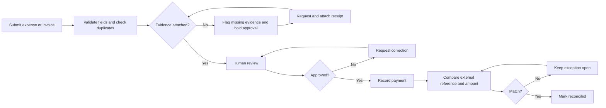

# LedgerFlow | Current-State and Future-State Accounting Process

**IS 3060-004 · WOC Accounting Consulting Project · November 24, 2026**  
**Rubric alignment:** Milestones 3 and 7 / Slides 5–6  
**Status:** Supplemental final-project process model. The current-state workflow is inferred from the case data and is not a verified observation of WOC's internal procedures.

## Business problem

The Lab 2 Tableau dataset contains 600 expense records. Receipt attachment and reconciliation status are observable in the data; the exact submission channels, approval sequence, staffing and follow-up procedures are not. The map below represents a plausible workflow to validate with WOC before implementation.

| Receipt status | Matched | Pending | Unmatched | Total |
| --- | ---: | ---: | ---: | ---: |
| Attached | 353 | 47 | 50 | 450 |
| Not attached | 22 | 36 | 92 | 150 |
| Total | 375 | 83 | 142 | 600 |

Unmatched spending totals $179,361.87, including $118,620.44 without receipts. These are recorded unmatched amounts, not confirmed losses. Missing receipts are associated with a higher unmatched rate; causation is not established.

## Current state (illustrative)

The dataset contains matched, pending and unmatched records even when receipts are absent. This map illustrates the documentation problem and a plausible review loop, not a claim that every historical transaction followed this sequence.

| Bottleneck | Business implication | Evidence strength |
| --- | --- | --- |
| Missing supporting documents | Harder to verify expenses; follow-up may be needed | Direct: 150/600 lacked receipts |
| Unmatched transactions | Outstanding reconciliation and review | Direct: 142/600 unmatched; 83/600 pending separately |
| Repeated manual follow-up | Potential staff time and delays | Inferred; measure during discovery |
| Limited exception visibility | Potential difficulty prioritizing incomplete records | Inferred; confirm with accounting team |

## Future state (LedgerFlow workflow)

In the classroom prototype, payment is simulated and reconciliation is manually entered. Evidence presence does not prove authenticity. A proposed future AI assistant may draft receipt requests, but an authorized employee reviews them and controls all financial decisions.

## Control and responsibility handoffs

| Stage | Responsible role (proposed) | Information / control |
| --- | --- | --- |
| Capture | Employee or submitting staff member | Supplier or employee, transaction ID, department, amount and supporting evidence |
| Validate | Accounting reviewer | Required fields, possible duplicate and missing-evidence flags |
| Approve | Authorized manager | Verify legitimacy, evidence and policy; no self-approval in production |
| Pay | Authorized payment staff | Confirm approval and record payment in the official accounting system |
| Reconcile | Accounting staff separate from payment where feasible | Match amount and external reference; investigate discrepancies |
| Monitor | Accounting lead | Review receipt completeness, unmatched and pending rates, and aged exceptions |

The production responsibilities and segregation of duties are recommendations. LedgerFlow Final demonstrates workflow logic but does not enforce authenticated user roles.

## Expected improvements and validation

- Increase receipt attachment from 75% baseline to a proposed 95% by December 2027.
- Reduce unmatched transaction rate from 23.7% to a proposed 12% by December 2027; monitor pending records separately to prevent relabeling exceptions as improvement.
- Establish a baseline for approval time and target a median of two business days for review-ready submissions.
- Validate the current process with staff and compare pilot performance against an equivalent baseline before attributing improvements to LedgerFlow.

## Evidence

- [Lab 2 Tableau workbook and analysis](../Lab-2/)
- [Lab 3 digital intake concept](../Lab-3/)
- [Lab 7 prototype and development history](../Lab-7/)
- [Implementation roadmap](04_Implementation_Roadmap.md)
