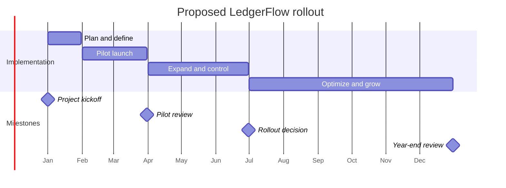

# LedgerFlow | 2027 Implementation Roadmap

**IS 3060-004 · WOC Accounting Consulting Project · November 24, 2026**  
**Rubric alignment:** Milestone 12 / Slide 11  
**Status:** Supplemental proposed rollout. Dates assume a January 2027 kickoff and depend on WOC approval, funding and validated pilot results. Targets are not achieved results.

## Objective

Introduce LedgerFlow's evidence and reconciliation workflow in stages rather than deploying an untested system across the organization. Keep the public classroom prototype restricted to fictional data. Select and validate a secure production platform before processing real information.

## 2027 timeline

| Date and phase | Key actions | Who is responsible (proposed) | Expected deliverable / decision |
| --- | --- | --- | --- |
| January 2027 (first 30 days): Plan & Define | Validate workflow with staff, confirm evidence policy, measure baselines, assess platform costs and security needs | Accounting lead coordinates; finance leadership approves scope; IT reviews security | Agreed requirements, baseline and pilot plan |
| February–March 2027 (days 60–90 review): Pilot Launch | Test secure workflow with fictional records first; train accounting and one department; collect feedback; use real data only after security gate | Accounting and IT run pilot; department manager supports training | Pilot review: receipt attachment target 90%, tested access and recovery controls, issue log |
| April–June 2027: Expand & Control | Resolve pilot defects, verify security, standardize approvals and exception queues, expand to additional departments only if ready | Finance leadership authorizes expansion; accounting and IT implement | Conditional rollout decision by June; comparable KPI results and control validation |
| July–December 2027 (months 6–12): Optimize & Grow | Monitor trends and adoption; review controls quarterly; assess integrations and a separate AI drafting pilot | Accounting lead reports KPIs; finance and IT evaluate enhancements | Year-end performance review and decision on future AI investment |

Roles above identify who would coordinate or approve each phase, not named WOC employees or actual assignments. Keep the slide visual concise and explain responsibilities verbally or in notes.

## Performance goals by December 2027

| KPI | Lab 2 baseline | Proposed target | How to measure |
| --- | --- | --- | --- |
| Receipt attachment rate | 75.0% (450/600) | 95% | Expenses with required supporting evidence attached / total eligible expense records, using consistent inclusion rules |
| Unmatched transaction rate | 23.7% (142/600) | 12% | Unmatched expenses / total eligible expenses, with consistent review cutoff and status definitions |
| Approval turnaround | Not recorded in Lab 2 | Median 2 business days | Business days from review-ready submission to final approval; measure separately from time awaiting missing documentation |

The receipt target means a 20-percentage-point improvement from the class dataset. The unmatched target means about an 11.7-percentage-point reduction. These are proposed aspirational goals, not forecasts or validated commitments. Confirm the baseline against comparable live pilot cohorts. The class dataset is a reference, not necessarily representative of future WOC transaction volumes.

### Supporting guardrails

- Track pending rate (baseline 83/600 = 13.8%) and aged exceptions separately. A lower unmatched rate must not result merely from reclassifying unmatched records as pending.
- Report percentage of all expenses with receipts, not only approved ones, to avoid overstating compliance.
- Track end-to-end submission-to-approval time alongside the review-ready metric so time spent awaiting receipts remains visible.
- Record monthly volume, receipt completeness, unmatched dollars and exception aging by department. Use comparable time windows and consistent definitions.
- Review training completion and feedback during the pilot; document causes of delays and correct workflow issues before expanding.

## Decision gates and change management

Before the pilot: approve the proposed expense policy, clarify responsibilities, obtain a production-platform estimate and confirm a safe test environment. Before any real-data use: verify role-based access, evidence storage, approval separation, audit logging, backup recovery and integration controls. Before expansion: address material defects, validate pilot metrics and obtain finance/IT approval. If targets are missed or controls fail, extend the pilot rather than expanding automatically.

The main adoption challenge is that employees may continue submitting expenses through familiar channels or delay attaching receipts. Address it with a short demonstration, a simple receipt checklist, department champions, a support channel and feedback sessions. Train approvers and accounting staff on exceptions, not just routine submissions. Explain why complete evidence protects both employees and the organization.

Future AI is optional and contingent on successful core workflow adoption. Test receipt-request drafting with fictional exceptions, measure correction rates and time saved, and require human approval before sending messages. Do not grant AI financial decision permissions.

## Evidence

- [Lab 2 Tableau dataset and dashboard](../Lab-2/)
- [LedgerFlow Final](../Lab-7/)
- [Process map](02_Accounting_Process_Map.md), [platform evaluation](01_Platform_Evaluation.md), [risk register](03_Cybersecurity_Risk_Register.md)
